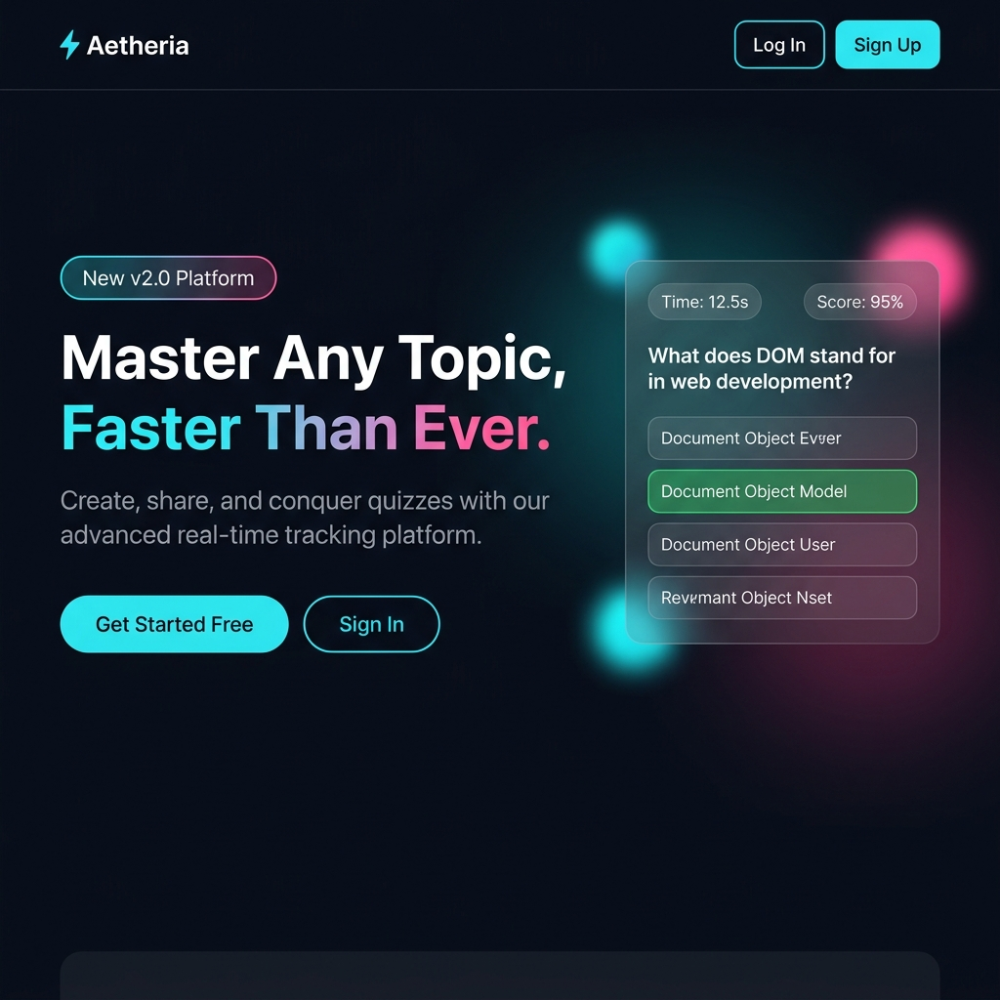
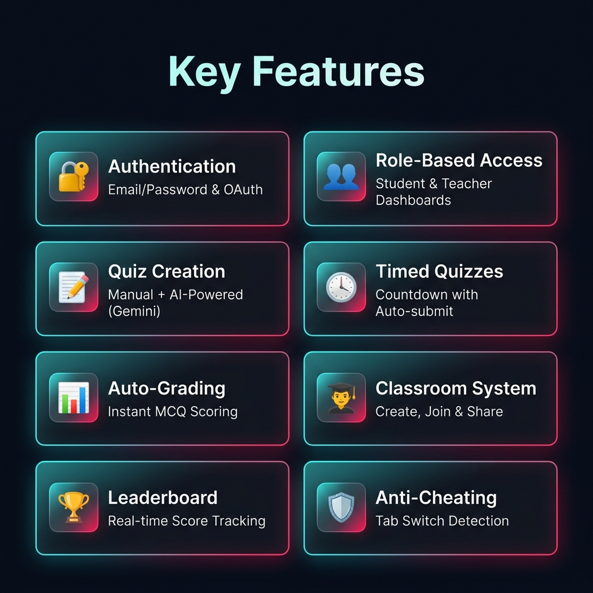
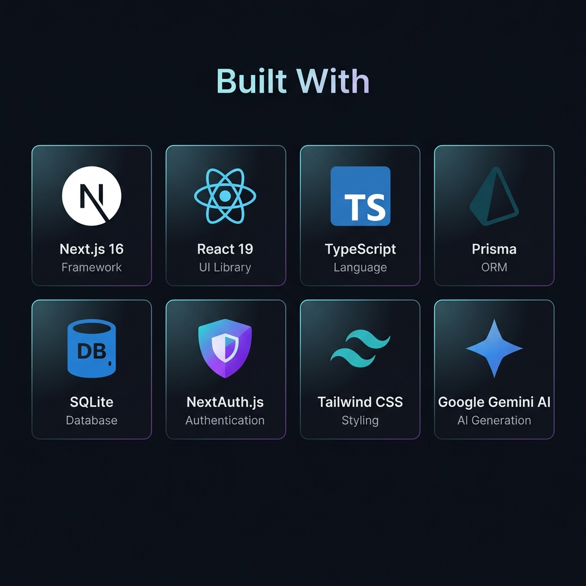
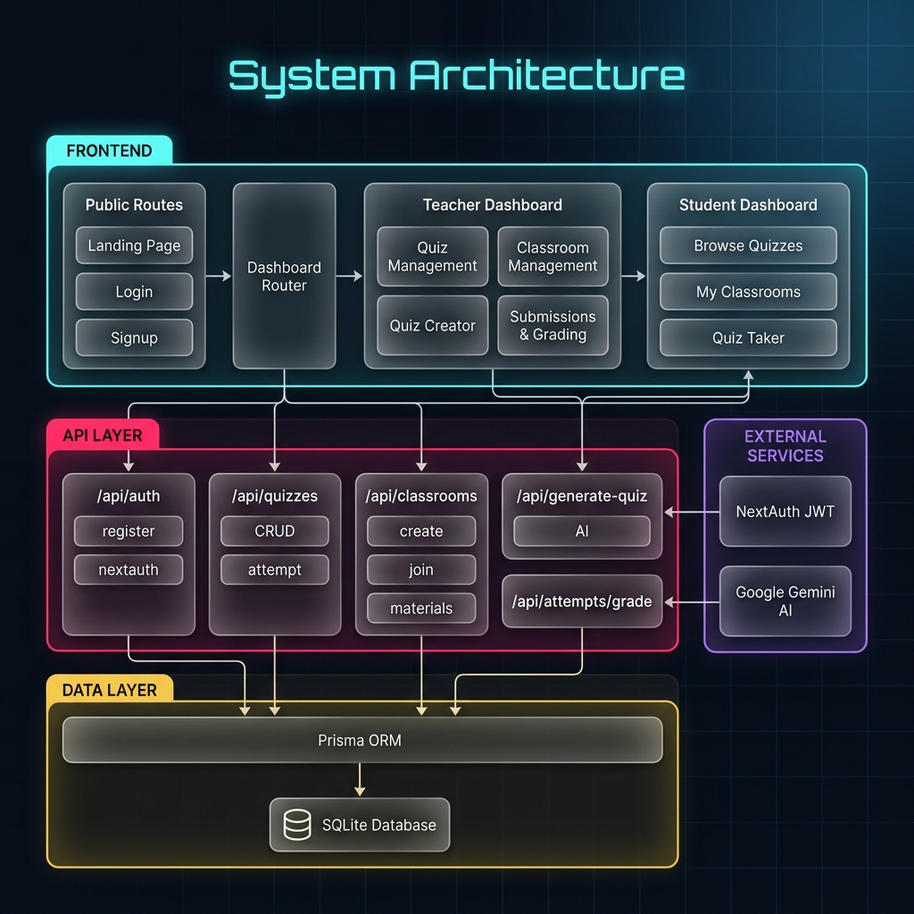
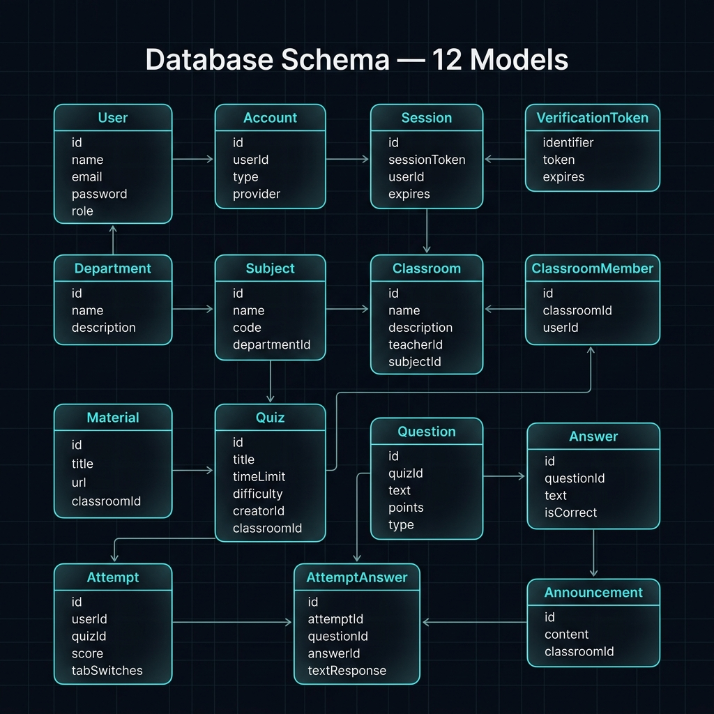
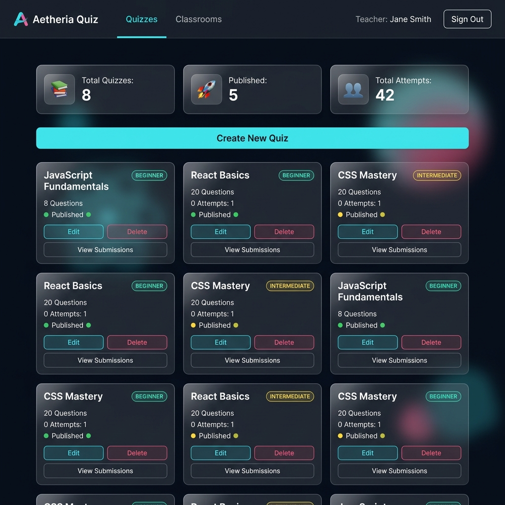
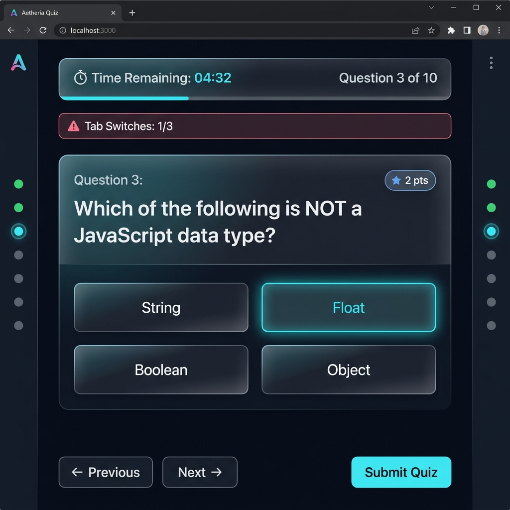
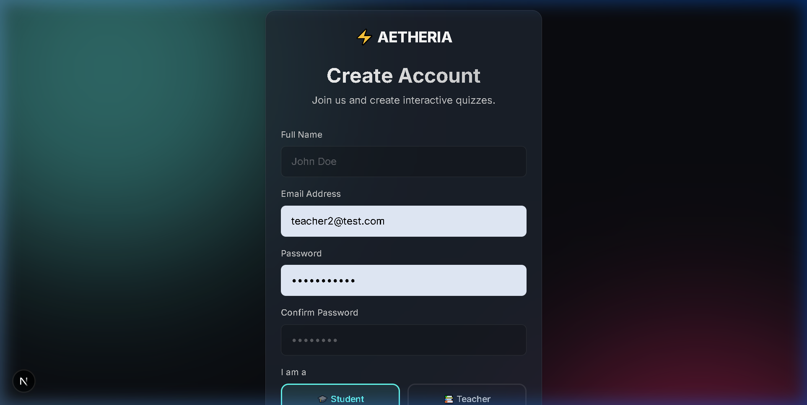

# ⚡ Aetheria Quiz — Online Quiz System

A modern, interactive online quiz platform built with **Next.js 16**, **Prisma ORM**, **SQLite**, and **NextAuth.js**. Features role-based dashboards (Student / Teacher), timed quizzes, AI-powered question generation, and a sleek glassmorphism dark UI.



---

## ✨ Features



- **🔐 Authentication** — Email/password signup & login via NextAuth.js
- **👥 Role-Based Access** — Student and Teacher dashboards with different capabilities
- **📝 Quiz Creation** — Teachers can create quizzes with MCQ + Subjective questions
- **🤖 AI Question Generation** — Generate quiz questions from topics or documents using Google Gemini AI
- **⏱️ Timed Quizzes** — Optional countdown timers with auto-submit
- **📊 Auto-Grading** — Instant MCQ scoring with manual subjective grading
- **🎓 Classroom System** — Create, join, and share classrooms with invite links
- **🏆 Leaderboard** — Real-time classroom score tracking
- **🛡️ Anti-Cheating** — Tab switch detection (3 strikes = auto-submit + flag)
- **📱 Responsive Design** — Works across desktop, tablet, and mobile

---

## 🛠️ Tech Stack



| Layer         | Technology                         |
|---------------|------------------------------------|
| **Framework** | Next.js 16 (App Router)            |
| **Language**  | TypeScript                         |
| **UI**        | React 19                           |
| **Database**  | SQLite (via Prisma ORM)            |
| **Auth**      | NextAuth.js v4 (Credentials + JWT) |
| **Styling**   | Tailwind CSS + CSS Modules         |
| **AI**        | Google Generative AI (Gemini)      |

---

## 🏗️ System Architecture



---

## 🗄️ Database Schema (12 Models)



The database contains 12 interconnected models:

| Model             | Purpose                                     |
|-------------------|---------------------------------------------|
| **User**          | Students, Teachers, and Admins              |
| **Account**       | OAuth provider accounts (NextAuth)          |
| **Session**       | Active user sessions                        |
| **Department**    | Academic departments                        |
| **Subject**       | Subjects within departments                 |
| **Classroom**     | Virtual classrooms managed by teachers      |
| **ClassroomMember** | Student enrollment in classrooms          |
| **Material**      | Study materials attached to classrooms      |
| **Quiz**          | Quizzes with settings (timer, difficulty)   |
| **Question**      | MCQ or Subjective questions in quizzes      |
| **Answer**        | Answer options for MCQ questions            |
| **Attempt**       | Student quiz attempts with scores           |
| **AttemptAnswer**  | Individual answer records per attempt      |
| **Announcement**  | Classroom announcements                     |

---

## 📸 Screenshots

### Teacher Dashboard


### Quiz Taking Interface


### Signup Page (Role Selection)


---

## 🚀 Prerequisites

Make sure you have the following installed:

| Tool        | Version | Download                                  |
|-------------|---------|-------------------------------------------|
| **Node.js** | v18+    | [nodejs.org](https://nodejs.org)          |
| **npm**     | v9+     | Comes with Node.js                       |

> **Note:** If Node.js is installed in a custom location (e.g. `C:\Nodejs\node-v25.6.0-win-x64`), make sure it is added to your system `PATH`, or prefix commands with the full path.

---

## 📦 Installation & Setup

### 1. Clone the repository

```bash
git clone https://github.com/your-username/Online-Quiz-System.git
cd Online-Quiz-System
```

### 2. Install dependencies

```bash
npm install
```

### 3. Configure environment variables

Copy the example file and fill in your values:

```bash
cp .env.example .env
```

The default `.env` uses **SQLite** (zero-config, no external database needed):

```env
# SQLite — stores data in prisma/dev.db (auto-created)
DATABASE_URL="file:./dev.db"

# NextAuth
NEXTAUTH_URL="http://localhost:3000"
NEXTAUTH_SECRET="any-random-secret-string-here"

# Google Gemini AI (optional — for AI quiz generation)
GEMINI_API_KEY="your-gemini-api-key"
```

> **Tip:** Generate a secure secret with:
> ```bash
> node -e "console.log(require('crypto').randomBytes(32).toString('hex'))"
> ```

### 4. Set up the database

Generate the Prisma client and push the schema to create your database:

```bash
npx prisma generate
npx prisma db push
```

This creates the SQLite database file at `prisma/dev.db` with all the required tables.

---

## ▶️ Running the Project

### Development Server

```bash
npm run dev
```

Then open **[http://localhost:3000](http://localhost:3000)** in your browser.

> **Windows Users:** If you encounter a Turbopack error (`native bindings are not available`), the `dev` script already uses the `--webpack` fallback. If you still face issues, run manually:
> ```bash
> npx next dev --webpack
> ```

### Production Build

```bash
npm run build
npm start
```

---

## 🗄️ Database Commands

| Command               | Description                                       |
|-----------------------|---------------------------------------------------|
| `npm run db:generate` | Regenerate the Prisma Client after schema changes |
| `npm run db:push`     | Push schema changes to the database               |
| `npm run db:studio`   | Open Prisma Studio (visual DB browser)            |

---

## 🏗️ Project Structure

```
Online-Quiz-System/
├── prisma/
│   ├── schema.prisma       # Database schema (models, relations)
│   └── dev.db              # SQLite database (auto-generated)
├── public/
│   └── images/             # README images & assets
├── src/
│   ├── app/
│   │   ├── api/
│   │   │   ├── auth/       # NextAuth + registration endpoints
│   │   │   ├── quizzes/    # Quiz CRUD & attempt submission
│   │   │   ├── classrooms/ # Classroom management APIs
│   │   │   ├── generate-quiz/ # AI quiz generation
│   │   │   └── attempts/   # Grading endpoints
│   │   ├── dashboard/      # Dashboard pages (student/teacher)
│   │   ├── login/          # Login page
│   │   ├── signup/         # Registration page (with role selector)
│   │   ├── quiz/[quizId]/  # Quiz taking interface
│   │   ├── layout.tsx      # Root layout
│   │   └── page.tsx        # Landing page
│   ├── components/ui/      # Reusable UI components (Button, Input, Card)
│   ├── lib/
│   │   ├── auth.ts         # NextAuth configuration
│   │   └── prisma.ts       # Prisma client singleton
│   └── types/
│       └── next-auth.d.ts  # Session type augmentation
├── .env                    # Environment variables (create from .env.example)
├── .env.example            # Template for environment variables
├── package.json
└── README.md
```

---

## 🔐 Security

| Area              | Implementation                                     |
|-------------------|---------------------------------------------------|
| Password Hashing  | bcrypt via `bcryptjs`                              |
| Answer Protection | `isCorrect` stripped before sending to client      |
| Auth Protection   | All API routes check `getServerSession`            |
| CSRF              | Handled by NextAuth                                |
| Role Enforcement  | Teacher/Student routes verify role before access   |
| Anti-Cheating     | Tab switch counter with auto-submit on 3 strikes   |

---

## 👥 User Roles

| Role        | Capabilities                                                             |
|-------------|-------------------------------------------------------------------------|
| **Student** | Browse quizzes, join classrooms, take quizzes, view scores & leaderboard |
| **Teacher** | Create quizzes (manual + AI), manage classrooms, grade submissions, share invite links |

---

## 📝 License

This project is for educational purposes (3rd Semester project).
